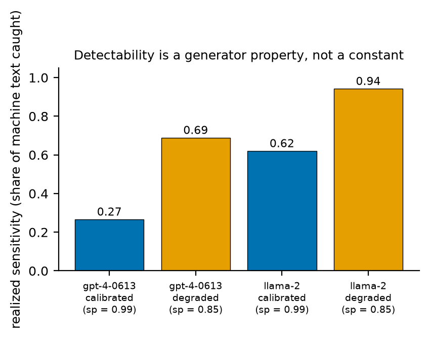
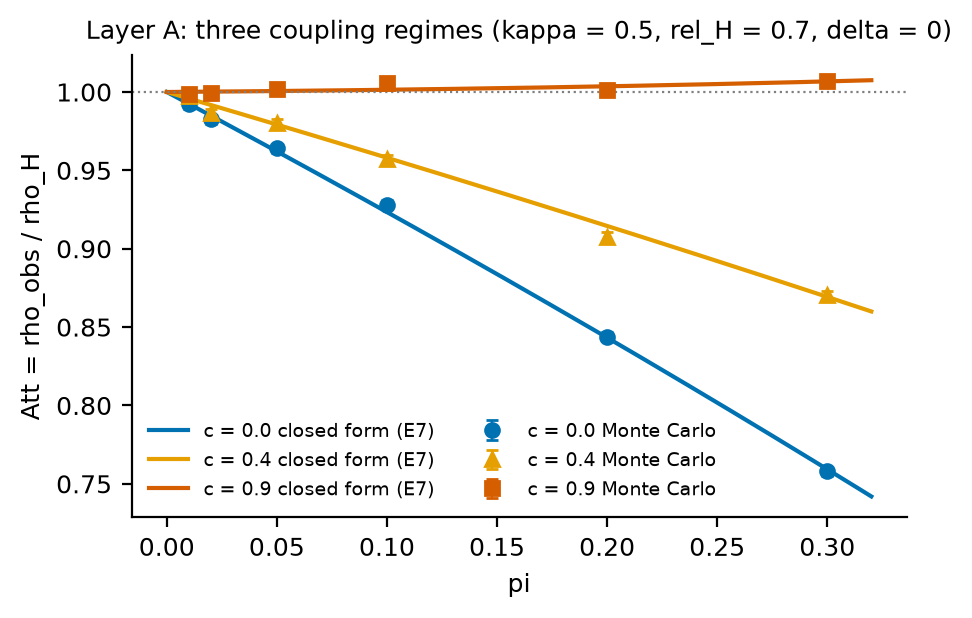
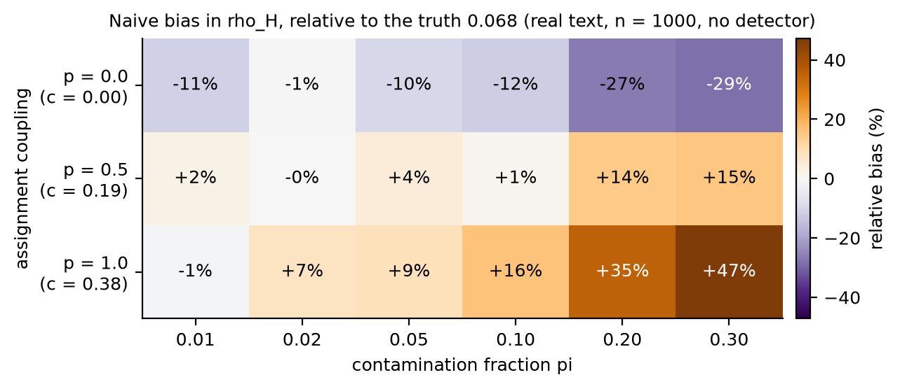
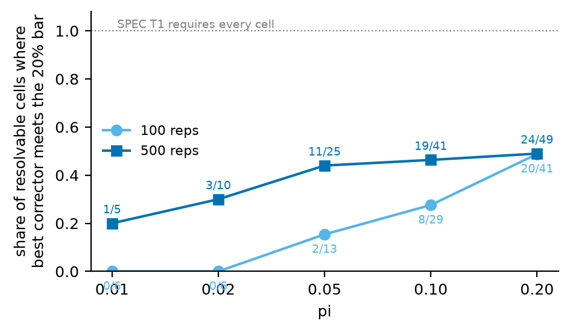
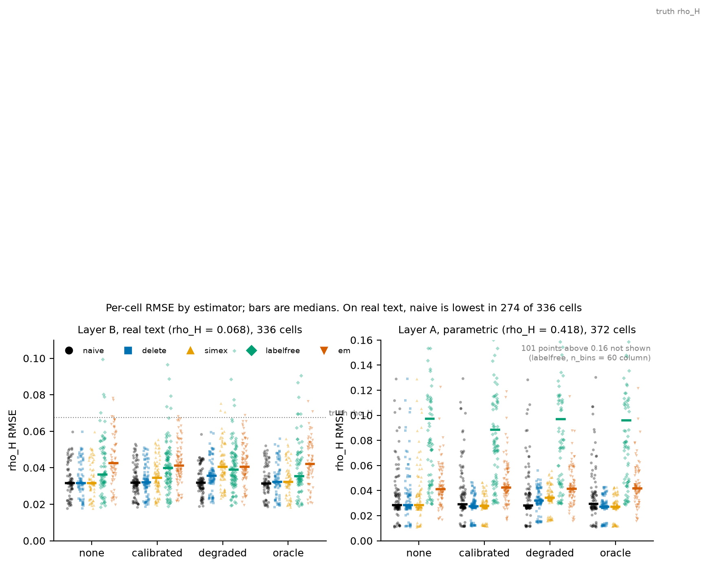
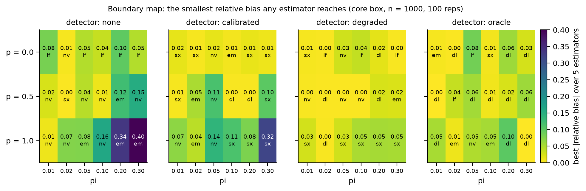
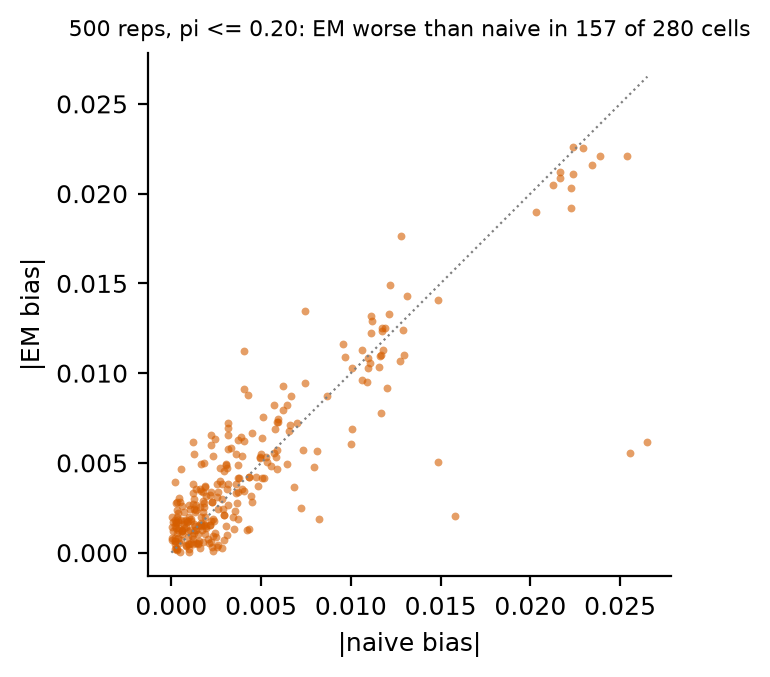
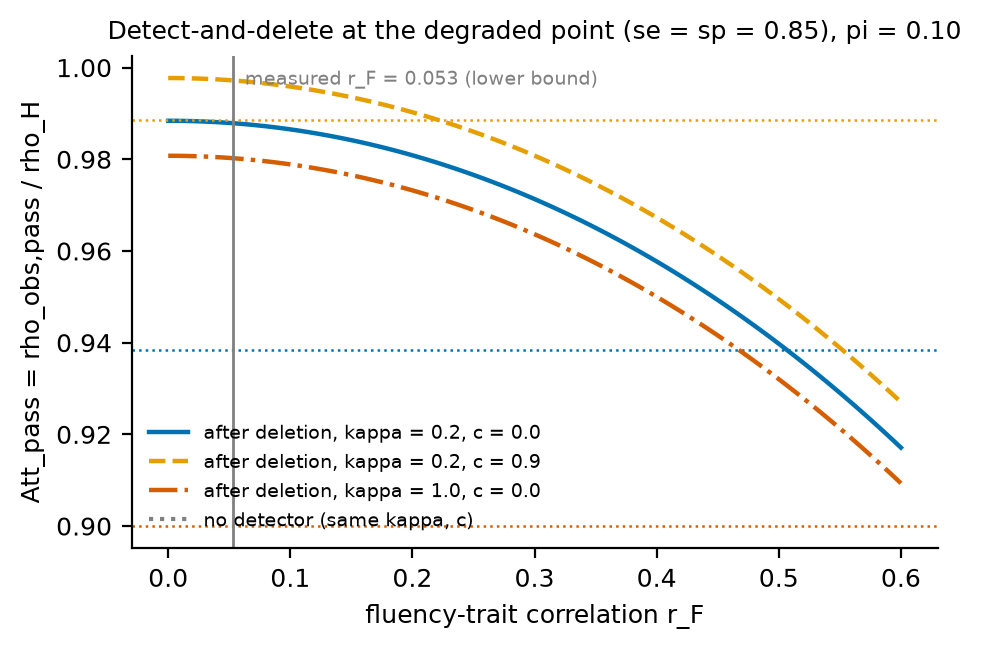

# Ghost respondents: a boundary map for covert AI authorship in open-ended survey data

Working paper, draft 2 (2026-09-13).

Author: Abhay Mettu. **Affiliation, corresponding address, and acknowledgements: PLACEHOLDER
- owner decision, deliberately not filled in.**

Numbers below are generated from the saved simulation outputs, not typed by hand:
`paper/scripts/make_tables.py` and `paper/scripts/make_figures.py` produce the tables in
`paper/tables/` and the figures in `paper/figures/`, which are the artifacts of record for
sections 4 through 6. The Layer A single-column re-runs added in draft 2 (simex at
B_boot = 50, labelfree at n_bins = 8, `bounds_c`) are read from
`lane4-simulation/results/b2-tables-recomputed.json` and the grids beside it, and are recorded
in `lane4-simulation/ESTIMATOR-FIX-REPORT.md`.

Unresolved items are listed under Open items at the end, with their status.

---

## Abstract

When a survey respondent pastes an open-ended item into a language model and submits the
output, the analytic sample stops being one measurement process and becomes a mixture of two,
with an unknown mixing fraction. I model that mixture, derive in closed form the bias it puts
in a validity coefficient, and test four corrections - detect-and-delete, misclassification
SIMEX, label-free prevalence estimation with an errors-in-variables correction, and a
two-class EM mixture - against four thresholds fixed in the analysis plan before the grid ran
(SPEC.md, commit db7c171; not externally registered), in two simulation layers: a
parametric layer that checks the algebra, and a semi-synthetic layer that injects real
machine-written personality essays into real human essays scored by an out-of-fold text model.

The algebra holds. 1116 Monte Carlo moments match the closed forms with no failures, and the
three-regime contamination map - attenuation at zero coupling, near-cancellation at
intermediate coupling, inflation at the pool's full coupling - reproduces on real text, from
-29% to +47% relative bias at 30% contamination.

The corrections do not hold. Three of the four thresholds fail outright and the fourth fails
at both realistic detector operating points. On real text the trait signal in a scored essay
chunk is weak (validity 0.068), so Monte Carlo and sampling variance dominate contamination
bias in most cells, every correction adds more variance than bias it removes, and the naive
estimator has the lowest RMSE in 274 of 336 cells. At five times the
replications the best corrector meets the bias bar in 28.5% of resolvable cells against a
requirement of 100%, and EM is slightly harmful. The deletion-selection bias scales with the
square of the correlation r_F between the trait and the variable the detector thresholds on.
That variable is the detector's own score, and its largest point-biserial correlation with the
five labels is 0.045, so the detector destroys about a tenth of a percent of trait variance.

What is left is a conditional sensitivity band. Taking the prevalence, the homogenization,
the mean gap and the human reliability as known, treating only the coupling as unidentified
inside [0, 1], inverting the closed form at both ends of that range, and unioning in the
sampling uncertainty of the observed correlation gives an interval that contains the human
validity coefficient in at least 93.6% of replications in every one of the 372 parametric
cells (median 97.4%). Coverage at that level is what the construction guarantees: the true
coupling lies inside the assumed range by definition and the other four inputs are supplied,
so the band is the naive Fisher interval widened by the identification range of c. It is
wider than that interval in all 372 cells, by a median factor of 1.28. The band is what a
sensitivity analysis reports, not a field-usable bound: the prevalence it conditions on is
itself not estimable here. The deliverable is the map of where deletion helps, where
correction helps, and where nothing beats doing nothing, with that band as the sensitivity
statement to attach when nothing does.

---

## 1. Introduction

### 1.1 The problem

Persistent cross-service AI agents that act on a person's behalf are now a consumer product,
sitting between that person and every service they touch, survey platforms included (Meta,
2026-09-08).

This changes where the stewardship problem for survey measurement lives. If a respondent's
open-ended answer is drafted, edited, or dictated by an agent like this before it reaches a
survey platform, the record of who authored the response - and the fidelity of what was
measured - lives one layer inside the respondent's own device and vendor of choice, not the
survey administrator's system. Detection then contends with something structurally different
from spam or a bot farm: a general-purpose assistant already mediating a person's outward
communication for legitimate, disclosed reasons, of which answering a survey is one small and
undifferentiated case.

How much of this is already in the data is a platform property rather than a constant. Zhang,
Xu, and Alvero (2025) get 34% self-reported LLM use on open-ended items; Xu and Malkin (2026)
find the rate running from under 10% on Prolific to over 80% on Mechanical Turk. The grid
below spans pi from 0.01 to 0.30 and is, on that evidence, conservative at the top.

The field's current response is detection followed by deletion: score every response with an
AI-text classifier, drop what the classifier flags, analyze what remains. Pew Research Center
(2026) tests trap questions, a commercial screen, and voter-file matching on 11,114 opt-in
respondents, and finds each of the three moves the estimate it was meant to clean - the
voter-file match made quality worse by dropping valid respondents who would not share contact
details. Gerber and Cash (2026) assemble bot checks, timing and logic checks, cross-response
similarity, and ten linguistic markers into a pipeline for identifying generative-AI use among
otherwise genuine responders. Panda et al. (2026) show LLM agents completing web surveys and
passing embedded attention checks by reading the exposed DOM. NORC has presented detection
tooling and bias mitigation for the same problem at AAPOR (Huang et al., 2025). All of them
treat the problem as detection, and none carries a correction step.

Detect-and-delete has two known weaknesses. Detectors miss, so contamination survives
deletion. And detectors err non-randomly: they flag non-native and low-fluency human writing
at higher rates (Liang et al., 2023; Park et al., 2026), and fluency correlates with the
traits open-ended items are used to measure, so deleting flagged text selects on the trait.
Zhang, Xu, and Alvero (2025) name the second concern in one sentence, as a risk analogous to
attention-check filtering, without formalizing it.

This paper treats contamination as a measurement problem rather than a detection problem.
The analytic sample is a two-component mixture: a human measurement process with its own
reliability and validity, and a machine process whose output carries some fraction of the
respondent's trait signal, parameterized by a coupling correlation c, and is homogenized
(machine text is less dispersed than human text). I derive the bias in the validity
coefficient as a closed form in the contamination fraction pi, the coupling c, the variance
ratio kappa, and the mean gap delta; I derive the survivor-sample bias of detect-and-delete
including the selection channel; and I test whether any of four estimators can recover the
human validity coefficient without gold-standard authorship labels.

### 1.2 What the paper finds

Three of the four analysis-plan thresholds (SPEC 4.4) fail outright and the fourth fails at
both realistic detector operating points (section 5.3). On real
text at realistic detector operating points the regime is variance-dominated: contamination
bias is smaller than the sampling noise of the coefficient in most cells, and every correction
that removes part of the bias adds more variance than it removes. The naive estimator has the
lowest median RMSE in every detector group. The deliverable is the map of where each strategy
helps and where none does.

Four results follow.

1. The contamination algebra is exact and reproduces on real text, including the sign flip
   from attenuation to inflation that the assignment rule alone produces (section 5.2).
2. The detector's realized sensitivity on frontier-model text at a 99% specificity operating
   point is 27% (Table 1).
3. The deletion-selection bias is O(r_F^2), and at the measured r_F it is negligible;
   section 5.6 gives it as a sensitivity table over r_F.
4. Conditioning on pi, kappa, delta and rel_H and treating only the coupling c as
   unidentified inside [0, 1] gives a sensitivity band on rho_H whose coverage is at least
   93.6% in every one of the 372 parametric cells (section 5.4). Coverage at that level
   follows from the construction rather than from the data: the true c is inside the assumed
   range by definition, and the band is the naive Fisher interval widened by the
   identification range of c, so it is never narrower than that interval and is wider in all
   372 cells. Its four conditioning inputs are what a field application would have to supply,
   and pi is not estimable here.

### 1.3 Relation to prior work

Three claims of novelty were checked against the two closest papers by full-text read. Messing's "Hidden Measurement Error in LLM Pipelines" (arXiv
2604.11581) decomposes variance inside an LLM-as-annotator pipeline and contains no
respondent, no authorship variable, and no sample-level mixture. Zhang, Xu, and Alvero (2025)
document homogenization and self-reported prevalence (34%) and frame correction as future
work. Neither builds the respondent-side mixture with a coupling parameter, a label-free
prevalence estimator tied to a validity correction, or the deletion-selection result. The
persona-conditioning literature (PersonaLLM, arXiv 2305.02547; Argyle et al., 2023) asks
whether trait conditioning shows up in generated text; I take that answer as a measured
input - the pool coupling - and propagate it through a correction the persona literature does
not attempt. Detect-and-delete is complete-case analysis, and
section 2.3 shows the missingness mechanism is the classifier itself, nonignorable whenever
detection errors correlate with a covariate of the trait (r_F != 0). The IRT literature on
nonignorable item nonresponse formalizes exactly this class of mechanism through selection
models (Heckman) and pattern-mixture models (Little), and through the multidimensional-IRT,
latent-regression, and multiple-group alternatives Rose, von Davier, and Nagengast (2015)
derive from them; Wu, Ma, and Chen (2026) extend the same lineage to a joint Bayesian model
of not-reached and omitted item nonresponse. That is adjacent machinery for a structurally
similar but substantively different problem (unanswered test items, not discarded complete
responses); I borrow its vocabulary for the selection channel in section 2.3 rather than its
estimators.

Two neighboring literatures need naming so they are not mistaken for this one. The first is
terminological. Contamination in this paper means machine-authored responses sitting inside an
analytic sample of human respondents. It is not the training-data contamination of LLM
evaluation, where the question is whether a model saw the instrument before being scored on
it; Han et al. (2025) measure that directly for psychometric inventories and find the Big Five
leaking into training data. The two problems share a word and little else, though they do meet
at one point this paper is exposed to, noted in Limitations.

The second is rectification: correct a downstream population estimate built from machine
output by spending a small amount of human data on debiasing. Krsteski et al. (2026) do this
for simulated survey responses and cut bias from 24-86% to under 5%; Lee et al. (2025) give
the plug-in version for LLM-as-a-judge evaluations with a human-labeled calibration set; the
prediction-powered family (Angelopoulos et al., 2023; Egami et al., 2023) is the general
machinery. All of them need gold labels on some subsample. This paper assumes there are none.
Section 3 states that assumption and section 7 discusses it; the label-free results here
apply to the no-label regime and say nothing about correction when labels exist.

---

## 2. The mixture model

Notation follows the derivation files (`derivations/lane1-zero-coupling.md`,
`derivations/lane1-partial-coupling.md`); equation numbers (E*) refer to those files, which
were verified by an independent blind re-derivation, a numerical pass against the
simulation, and an adversarial methods review (SPEC section 7).

### 2.1 Setup

Respondent i has latent trait theta with variance s2_T, an outcome w = b theta + u, and a
scored open-ended response x. Authorship A in {H, M} is unobserved with pi = P(A = M).

Human process: x = mu_H + theta + e, Var(e) = s2_H, V_H = s2_T + s2_H, reliability
rel_H = s2_T / V_H. The clean-sample observed validity is rho_H = Cor(x, w | H) =
sqrt(rel_H) rho_T with rho_T = Cor(theta, w). Following decision N2, rho_H is the headline
estimand and rho_T the robustness estimand: "bias" below means contamination bias and
excludes classical attenuation.

Machine process: x = mu_M + m with Var(m) = s2_M and coupling c = Cor(x, theta | M).
Exactly for second moments, m = lambda_M theta + v with lambda_M = c sqrt(s2_M / s2_T).
Standardized parameters: kappa = s2_M / V_H (homogenization when kappa < 1), delta =
(mu_H - mu_M) / sqrt(V_H), and the machine slope g = c sqrt(kappa / rel_H).

Assumption A1 (ignorable authorship): A is independent of (theta, u, e, v). A2: v is
independent of u.

### 2.2 Observed moments and the three regimes

With N(pi, c) = (1 - pi) + pi g and Den(pi) = (1 - pi) + pi kappa + pi (1 - pi) delta^2,

    rho_obs = rho_H * N(pi, c) / sqrt(Den(pi)),    Att(pi, c) := N / sqrt(Den)          (E5, E7)

At c = 0, Att_0 = (1 - pi) / sqrt(Den) is strictly between 0 and sqrt(1 - pi): zero-coupling
contamination always attenuates and never flips sign (Prop. 1), and it is strictly
decreasing in pi for every kappa and delta (Prop. 3, which is hypothesis H1 exactly at
c = 0). Homogenization makes contamination less harmful than pure dilution and a mean gap
makes it more harmful; the crossover is kappa + (1 - pi) delta^2 = 1 (Prop. 2).

At fixed pi, Att is affine and increasing in c (E36), so there are three regimes with
explicit thresholds c_1(delta) = 2 sqrt(kappa rel_H) / S and c_2(delta) = S sqrt(rel_H) /
(2 sqrt(kappa)), S = 1 + kappa + delta^2 (Prop. 12): Att decreases in pi for c <= c_1,
increases for c >= c_2, and is U-shaped between. To first order,

    bias(rho_obs) = pi rho_H sqrt(kappa / rel_H) [ c - c_2(delta) ] + O(pi^2)            (E39)

so the sign of the contamination bias is the sign of c - c_2. A faithful amanuensis (c = 1,
kappa = 1, delta = 0) is not harmless: Att = 1 + pi (1 / sqrt(rel_H) - 1) > 1 (E76). The
only exactly harmless machine is the human replica.

### 2.3 Detect-and-delete and the survivor sample

A detector with sensitivity se = P(flag | M) and specificity sp = P(pass | H) leaves residual
contamination pi' = (1 - se) pi / [(1 - se) pi + sp (1 - pi)] (E30). Model the human error
as a threshold on a fluency score F = r_F theta / sqrt(s2_T) + sqrt(1 - r_F^2) eta, pass iff
F > tau, tau = Phi^{-1}(1 - sp). Among passed humans the trait variance shrinks by
q = 1 - r_F^2 psi (E33), with psi = lambda (lambda - tau) and lambda the truncated-normal
mean, and

    rho_H,pass / rho_H = q / sqrt[ (1 - rel_H (1 - q)) (1 - rho_T^2 (1 - q)) ] < 1        (E34)

whenever r_F != 0, sp < 1, and the human measurement is not both perfectly reliable and
perfectly valid (Prop. 11). This is indirect range restriction induced by the detector; it
does not depend on pi or se and is present in a clean sample run through a detector. The
threshold rule on F is, formally, a univariate normal selection model in the sense of Heckman
(1976, 1979): pass status is a latent propensity correlated with the trait, thresholded to
produce a binary indicator, which is the same construction the IRT nonignorable-nonresponse
literature (Rose, von Davier, and Nagengast, 2015) uses to model omitted and not-reached test
items. Under that literature's terms, detect-and-delete is complete-case analysis and the
range restriction above is what happens when the mechanism is NMAR by construction.

Combining residual contamination, range restriction, and the mean gap the detector
manufactures between surviving humans and machines gives the survivor validity
rho_obs,pass = rho_H Att_pass with Att_pass = N_pass / sqrt(Den_pass W_pass) (E48 to E51).
Prop. 14 establishes that this bias does not vanish as se -> 1, is not monotone along a ROC
curve, and never flips sign on the grid. Every term of the selection channel enters through
q, so the whole effect is O(r_F^2). Section 5.6 shows what that costs the argument.

---

## 3. Estimators

Five estimators make up the frozen grid's field. Each returns rho_H_hat, rho_T_hat =
rho_H_hat / sqrt(rel_hat), a Fisher interval where one exists, and pi_hat where the method
produces one. Three more are registered in `lane4-simulation/estimators.py` and run on
subsets: `bounds_c` below, and the `robust_t` / `robust_grm` pair of section 5.7.

- **naive**: Cor(x_1, w) on the full sample, x_1 the headline single indicator.
- **delete** (detect-and-delete): the same correlation on the detector's pass set.
- **simex** (misclassification SIMEX, after Kuchenhoff, Mwalili, and Lesaffre, 2006):
  treats the detector's (se, sp) as known, adds synthetic extra misclassification at lambda in
  {0, 0.5, 1, 1.5, 2} with 20 pseudo-datasets per lambda, refits, and extrapolates
  quadratically to lambda = -1. It returns no interval unless its outer bootstrap is opted
  into, and both headline grids ran with B_boot = 0. Layer A was later re-run on the simex
  column alone at B_boot = 50 (`results/grid-simex-boot50/`, 372/372 cells), so simex's
  coverage is testable there and reported in section 5.1; on Layer B it is still not. The
  point estimate is untouched by B_boot, so every simex bias and RMSE number in this paper is
  the same in both runs. SPEC 3.1. What is tested here is the 2006 method as implemented; no
  newer misclassification-SIMEX variant was verified in the scan (`docs/LIT-SCAN.md` C3).
- **labelfree** (label-free prevalence plus errors-in-variables, SPEC 3.2, the analysis
  plan's primary): estimates pi by matching the observed score distribution to a
  mixture of machine-reference and human-reference distributions on a Hellinger criterion
  with n_bins = 8 (the default changed from 60 to 8 after the Layer A grid completed;
  section 5.1 reports both), then inverts the moment equations of section 2.2 for mu_H, V_H,
  rel_H and Att at c_known = 0 and divides rho_obs_hat by Att_hat.
- **em** (full joint mixture, SPEC 3.3): a two-component Gaussian mixture on the k = 4
  indicators and w with 10 initializations and a 100-draw parametric bootstrap, warm-started
  from the point fit.
- **bounds_c** (partial identification, SPEC hypothesis H5): returns no point estimate for
  rho_H, only a bracket. It takes the coupling c as unidentified inside a stated interval,
  inverts (E7) at both endpoints using the fact that Att is affine and increasing in c (E36),
  and unions the resulting identification interval with a 95% Fisher-z sampling interval on
  rho_obs_hat, in the sense of Imbens and Manski (2004). It treats pi, rel_H, kappa and delta
  as known structural inputs and brackets c alone; section 5.4 says what conditioning on a
  known pi costs in practice. Added after the frozen grid, unit-tested against
  from-scratch closed forms (7 checks, 39/39 in `test_estimators.py`), and run on all 372
  Layer A cells (`results/grid-bounds-c/`). Section 5.4 reports it.

Two estimator defects found by line-by-line review before any grid run are recorded in
`board.md`: EM had been stopping on sklearn's default tolerance while reporting convergence,
and the parametric bootstrap had been resampling one dataset. Both were fixed before the
pilot cell.

**The standing assumption is that no authorship labels exist.** Not one label, not a small
gold subsample. That is what separates this setting from the prediction-powered and
design-based families (Angelopoulos et al., 2023; Egami et al., 2023; Zrnic and Candes, 2024),
from rectification for simulated survey responses (Krsteski et al., 2026), and from the
plug-in judge correction of Lee et al. (2025), all of which are valid and expected to dominate
anything here as soon as a labeled subsample is available. Every negative result in section 5
is a result about the no-label regime (section 7).

---

## 4. Simulation design

### 4.1 Layer A: parametric Monte Carlo

Purpose is proof, not realism (SPEC 4.1). theta ~ N(0, 1), k = 4 parallel human indicators,
machine indicators from the coupling-c process, w = rho_T theta + u, rel_H = 0.7, rho_T =
0.5, so rho_H = 0.418. Detector: a Gaussian fluency threshold with r_F = 0.3 on the human
side and Bernoulli(se) flags on the machine side, at (se, sp) = none (0, 1), calibrated
(0.95, 0.99), degraded (0.85, 0.85), oracle (1, 1). Grid: pi in {0.01, 0.02, 0.05, 0.10,
0.20, 0.30} x c in {0, 0.4, 0.9} x n in {500, 1000, 5000} x detector, at kappa = 0.5 (the
base arm, 216 cells), plus a kappa arm at {0.2, 1.0} and n = 1000 (144 cells) and a rho_v =
0.5 slice (12 cells): 372 cells, 500 replications each, master seed 20260907, delta = 0
throughout. Seeds are per (cell_id, rep) so a replication does not depend on execution
order (`GRID-CONFIG.md`).

### 4.2 Layer B: real text

**Human base.** The Pennebaker and King (1999) stream-of-consciousness essays, 2,467 texts
with binary median-split Big Five labels (the IEEE DataPort mirror carries no continuous
scores; `lane3-testbed/TESTBED-REPORT.md`). Layer B defines theta := L, the binary label.

**Scoring.** Each essay is split into four sentence-count chunks; each chunk is embedded
(`all-MiniLM-L6-v2`, which truncates at 256 tokens) and scored by a ridge classifier for the
trait. Human chunks are scored strictly out of fold: the fold model that scored a chunk never
saw its parent essay (`CHUNK-REFIT.md`). This matters. An earlier in-sample scoring path
inflated chunk validity by 1.79x to 4.33x; on out-of-fold scores the chunk-1 validity for
EXT is r_H = 0.135, and the four chunk validities are 0.135, 0.131, 0.134, 0.094, flat rather
than decaying. The 336-cell grid was re-run on the out-of-fold columns after the leak was
found; no number here comes from the in-sample run.

**Machine pools.** PersonaLLM stories (arXiv 2305.02547): 320 texts per generator, each
written by a model prompted with a Big Five persona, so each text carries a label for every
trait. The frontier generator is `personallm_gpt-4-0613`; the open generator is
`personallm_llama-2`. The pools are scored by the same fold models (never trained on them).
Lane 3's pool measurements give, for EXT, c_pool = 0.379 (kappa = 0.798, delta = +0.534,
g = 1.862) on gpt-4 and c_pool = 0.194 (kappa = 0.537, delta = +0.264, g = 0.780) on
llama-2.

**Injection (the assignment-coupling design, Prop. 16).** Draw a bootstrap human sample of
size n, replace a fraction pi of respondents with machine texts, and assign each machine text
to its respondent by one of three rules: random (p = 0), label-matched (p = 1), or matched
with probability p. Prop. 16 proves that c(p) = p c_pool and g(p) = p g_pool exactly, with
kappa and delta fixed, so p moves the coupling along a straight line at zero generations.
Two disclosures the design carries (`INJECT.md` section 7): the outcome w = rho_T theta + u
is synthetic (no corpus on file has an outcome), and the p arms rematch pre-existing texts
rather than varying disclosure at generation time, so nothing here speaks to how a real
respondent would behave when outsourcing an answer.

**Detector.** `roberta-base-openai-detector` scores from lane 3. The threshold is set at a
quantile of the human detector scores so specificity is chosen (0.99 "calibrated", 0.85
"degraded") and sensitivity is measured. Table 1 gives the realized rates.

**Table 1. Realized detector operating points (Layer B, EXT).**

| pool | detector | sp target | realized sp, mean [min, max] | realized se, mean [min, max] | cells |
|---|---|---|---|---|---|
| gpt-4-0613 | calibrated | 0.99 | 0.989 [0.988, 0.990] | 0.266 [0.244, 0.286] | 54 |
| gpt-4-0613 | degraded | 0.85 | 0.849 [0.846, 0.852] | 0.688 [0.664, 0.712] | 54 |
| llama-2 | calibrated | 0.99 | 0.989 [0.989, 0.990] | 0.620 [0.601, 0.633] | 18 |
| llama-2 | degraded | 0.85 | 0.849 [0.848, 0.851] | 0.942 [0.931, 0.946] | 18 |

At the in-domain operating point the detector catches about 27% of frontier-model text and
62% of the open model's text. Detectability is a generator property, not a constant
(Figure 7).

{width=58%}

**Figure 7. Realized detector sensitivity by generator pool and operating point (Table 1).** At the in-domain operating point the detector catches about 27% of frontier-model text and 62% of the open model's text.


**The box.** 336 cells at k = 4, rho_T = 0.5, machine draws with replacement, n_bins = 8:
a core box of 216 cells (pi(6) x detector(4) x n in {500, 1000, 2400} x p in {0, 0.5, 1},
gpt-4, EXT); a generator arm of 72 cells (llama-2, n = 1000, full pi x detector x p); and a
trait arm of 48 cells (NEU, AGR, CON, OPE at n = 1000, p = 0.5, calibrated and degraded).
100 replications per cell (SPEC 4.3), master seed 20260909, six frozen calibration splits
(one per pool-trait pair). This adapts SPEC 4.3 in two stated ways: the generator arm is
reduced on n (n moves sampling variance, not population moments), and SPEC's coupling axis
is realized through p as c = p c_pool, which caps the reachable coupling at 0.379, below
Layer A's "partial" (0.4). Consequently SPEC 4.4's condition c <= partial holds in every
cell, and the high-c corner SPEC anticipates for the boundary map is unreachable with these
pools.

**The estimand is small.** Truth is rho_H = rho_T * r_H(chunk 1) = 0.5 * 0.1351 = 0.0676
for EXT. At n = 1000 the naive MCSE over 100 replications is about 0.0031, about 4.6% of
the truth per MCSE (a 95% half-width of about 9% relative). This is the fact every threshold
below inherits. The between-chunk correlation on out-of-fold scores is 0.2096 against the
true single-chunk reliability r_H^2 = 0.0183, an overstatement of 11.5x, which is the
"weak-H2" failure: between-chunk consistency does not identify rel_H on this corpus within
the tested scoring setup (`WEAK-H2-DIAGNOSIS.md`, as narrowed in `PASS3-FIXES.md`).

### 4.3 The analysis-plan thresholds (SPEC 4.4)

- T1: corrected bias at most 20% of naive bias in every cell with pi <= 0.20 and c <= partial.
- T2: 95% CI coverage inside [92, 98].
- T3: |pi_hat - pi| at most 0.02 at n = 1000.
- T4: correction beats detect-and-delete on RMSE at the calibrated and degraded operating
  points; concede oracle.

The thresholds were fixed in the analysis plan before any grid run and are evaluated as
written on the cell set of 4.2. SPEC.md is a file in this repository, frozen at commit
db7c171; it was not registered with OSF, AsPredicted, or any other external registry, and it
was amended after the grids ran to add the `bounds_c` estimator of section 5.4. "Fixed in the
analysis plan" below means exactly that and not pre-registration.

---

## 5. Results

### 5.1 Layer A: the algebra holds, and the corrections already struggle

Every closed-form moment reproduces. Over the 372 cells, the naive rho_H bias against the
closed-form rho_obs - rho_H has a maximum |z| of 3.16 and zero exceedances of the
analysis plan's z* = 4.081 (mean z = -0.18); pass 2 (`pass2-numerical-check.md`) reports 1116
per-cell comparisons over three moments with zero failures, 4092 exactness checks against
`population.py` to 4.4e-16, and 142 hand-computed numbers reproduced. Table 2 shows the
three regimes at n = 1000.

**Table 2. Layer A attenuation Att = rho_obs / rho_H, closed form (E7) / Monte Carlo
(MCSE), n = 1000, no detector, 500 reps.**

| pi | kappa | c = 0 | c = 0.4 | c = 0.9 |
|---|---|---|---|---|
| 0.10 | 0.2 | 0.938 / 0.941 (0.003) | 0.961 / 0.961 (0.003) | 0.988 / 0.987 (0.003) |
| 0.10 | 0.5 | 0.923 / 0.928 (0.003) | 0.958 / 0.957 (0.003) | 1.001 / 1.006 (0.003) |
| 0.10 | 1.0 | 0.900 / 0.898 (0.003) | 0.948 / 0.947 (0.003) | 1.008 / 1.008 (0.003) |
| 0.30 | 0.2 | 0.803 / 0.801 (0.003) | 0.877 / 0.878 (0.003) | 0.969 / 0.969 (0.003) |
| 0.30 | 0.5 | 0.759 / 0.758 (0.003) | 0.869 / 0.870 (0.003) | 1.007 / 1.007 (0.003) |
| 0.30 | 1.0 | 0.700 / 0.701 (0.003) | 0.843 / 0.843 (0.003) | 1.023 / 1.024 (0.003) |

At kappa = 0.5 the thresholds are c_1 = 0.789 and c_2 = 0.887, so c = 0.9 sits in the
inflation regime and c in {0, 0.4} in the attenuation regime, exactly as the table reads
(Figure 5).

{width=66%}

**Figure 5. Layer A: three coupling regimes (kappa = 0.5, rel_H = 0.7, delta = 0).** Closed form (E7) against Monte Carlo, attenuation at c = 0 and c = 0.4 and inflation at c = 0.9.


Layer A is the regime in which the corrections were designed to work: rho_H = 0.418, and
the naive RMSE with no detector is 0.0285, 6.8% of the estimand, so the box is
bias-dominated at moderate pi. Even here the thresholds fail (Table A1 in the appendix, and
`derivations/pass3-methods-review.md` B2, recomputed at the estimators' shipped
configuration in `lane4-simulation/ESTIMATOR-FIX-REPORT.md` section 4): simex meets the T1 bar
in 38.6% of the 210 applicable cells (median bias ratio 0.34), delete in 34.3%, em in 11.9%,
labelfree in 0% at 60 bins and 9.5% at 8 bins. Delete is the only estimator that reaches
nominal rho_H coverage with any regularity (309/372 cells), against naive 224/372, em 52/372,
labelfree 0/372 at 60 bins and 59/372 at 8 bins, and simex 105/372 once it has an interval at
all. Prevalence error at n = 1000 has median 0.068 (em) and 0.148 at 60 bins or 0.071 at 8
bins (labelfree), against a bar of 0.02, with 7/228 and 0/228 passing. On RMSE against
deletion, simex wins 22/102 calibrated and 12/90 degraded cells, labelfree 0/102 and 13/90.
Deletion, by contrast, beats naive in 61/102 calibrated cells. In Layer A the corrections are
weak; in Layer B they lose to doing nothing.

Several of those numbers are new to this draft and come from single-column re-runs of the frozen
372-cell grid, each reusing the original per-replication RNG streams so no other estimator's
draws move (`run_grid_column.py`). The labelfree column was re-run at the shipped n_bins = 8
(`results/grid-labelfree-nbins8/`), which lifts its coverage from 0/372 to 59/372, halves its
median prevalence error from 0.148 to 0.071, and drops its median bias ratio from 5.9x naive
to 1.9x. Each remains outside its threshold. The simex column
was re-run at B_boot = 50 (`results/grid-simex-boot50/`), which makes its coverage testable
for the first time: median 0.910, 75.8% of cells at or above 90%, but only 105/372 (28.2%)
inside SPEC's [0.92, 0.98] band, and the fraction inside the band *falls* with sample size
(0.319 at n = 500, 0.303 at n = 1000, 0.181 at n = 5000). An interval that gets worse as n
grows is not missing sampling noise; it is inheriting SIMEX's own extrapolation bias, which no
bootstrap size removes.

### 5.2 The contamination map on real text

Figure 1 and Table 3 give the naive bias in the core box at n = 1000 with no detector.

{width=92%}

**Figure 1. Naive bias in rho_H, relative to the truth 0.068 (real text, n = 1000, no detector).** The cells of Table 3: rows are the assignment coupling p with its c, columns the contamination fraction pi.


**Table 3. Naive rho_H bias on real text (core box, EXT, n = 1000, detector none, truth
0.0676, 100 reps; MCSE 0.0028 to 0.0032 in every cell).**

| p (coupling) | pi = 0.01 | 0.02 | 0.05 | 0.10 | 0.20 | 0.30 |
|---|---|---|---|---|---|---|
| 0.0 (c = 0) | -0.0077 | -0.0004 | -0.0067 | -0.0082 | -0.0180 | -0.0194 |
| 0.5 (c = 0.19) | +0.0017 | -0.0002 | +0.0029 | +0.0007 | +0.0098 | +0.0103 |
| 1.0 (c = 0.38) | -0.0007 | +0.0050 | +0.0058 | +0.0108 | +0.0238 | +0.0319 |

As relative bias: -1% to -29% at c = 0 (dilution), +15% at c = 0.19 and pi = 0.30, and +47%
at c = 0.38 and pi = 0.30 (inflation). This is the three-regime map of section 2.2 on real
words: the same machine pool, the same kappa and delta, moved from attenuation to inflation
by the assignment rule alone, with g = 1.862 above the first-order inflation threshold as
(E39) requires. The pilot cell (`LAYERB-PILOT.md`) had shown the same mechanism at pi =
0.10 with 400 replicates per arm (closed-form Att 0.895 at p = 0 to 1.135 at p = 1; Monte
Carlo 0.868 to 1.138).

### 5.3 The four thresholds

**Table 4. SPEC 4.4 on real text.**

| # | threshold | verdict | headline number (100 reps) | at 500 reps (pi <= 0.20 slice) |
|---|---|---|---|---|
| T1 | corrected bias <= 20% of naive, every cell with pi <= 0.20, c <= partial | FAIL | best estimator (simex) 29/280 verbatim; 19/95 where naive bias is resolvable | 48/280 verbatim; 37/130 resolvable |
| T2 | CI coverage inside [92, 98] | FAIL (rho_T), PARTIAL (rho_H) | rho_T: 0/336 naive, 0/336 delete, 0/336 em, 1/336 labelfree; rho_H naive median 0.950, 261/336 in band | rho_T 0/280 naive |
| T3 | abs(pi_hat - pi) <= 0.02 at n = 1000 | FAIL | median 0.0546 (labelfree), 0.0637 (em); 5/192 and 0/192 pass | labelfree median 0.0528, 3/160 pass |
| T4 | correction beats deletion on RMSE at calibrated and degraded | FAIL | 10/96 calibrated, 41/96 degraded; naive has the lowest median RMSE in all four detector columns | 38/160 (down from 47) |

**T1.** All 280 cells with pi <= 0.20 are applicable. The bar is a ratio against the naive
bias, and at 100 replications that bias is not resolvable in most of the box: the median
|naive bias| / MCSE is 1.26, and only 95 of 280 cells (34%) have a naive bias larger than 2
MCSE. The other 185 (66%) are unresolved, which means the naive bias is inside 2 MCSE of
zero, not that it is zero. Table 5 gives both readings.

**Table 5. T1 at 100 replications.**

| estimator | meets 20% bar (all 280) | reduces bias at all (all) | meets 20% bar (95 resolvable) | reduces bias (resolvable) |
|---|---|---|---|---|
| delete | 24/280 (8.6%) | 141/280 (50.4%) | 14/95 (14.7%) | 67/95 (70.5%) |
| simex | 29/280 (10.4%) | 146/280 (52.1%) | 19/95 (20.0%) | 71/95 (74.7%) |
| labelfree | 20/280 (7.1%) | 90/280 (32.1%) | 12/95 (12.6%) | 44/95 (46.3%) |
| em | 14/280 (5.0%) | 117/280 (41.8%) | 5/95 (5.3%) | 54/95 (56.8%) |

The threshold fails by a factor of four to five even on the resolvable subset, but the
structure is informative: the pass rate rises with prevalence because prevalence is what
creates a bias worth removing. Best of the three correctors on the resolvable cells by pi:
0/6, 0/6, 2/13, 8/29, 20/41 at pi = 0.01, 0.02, 0.05, 0.10, 0.20 (Figure 4). Section 5.5
re-runs this slice at 500 replications.

{width=66%}

**Figure 4. T1 on the resolvable cells by prevalence, at 100 and 500 replications.** Share of resolvable cells where the best corrector meets the 20% bar, with the passing count over the resolvable count at each pi. SPEC T1 requires every cell.


**T2.** SPEC's coverage threshold is assessed on rho_H; the rho_T rows are an additional
diagnosis. On rho_H the median cell is at nominal coverage for naive and delete (0.950) and
the failures concentrate where bias dominates variance: of naive's 75 failing cells, 61 are
under-coverage, worst at (p = 1, pi = 0.30) and (p = 1, pi = 0.20). Naive coverage near
nominal reflects a bias that is small relative to the interval width, not a correction that
succeeded.

| estimator | rho_H in band | rho_H median | rho_T in band | rho_T median |
|---|---|---|---|---|
| naive | 261/336 (77.7%) | 0.950 | 0/336 | 0.000 |
| delete | 281/336 (83.6%) | 0.950 | 0/336 | 0.000 |
| labelfree | 222/336 (66.1%) | 0.930 | 1/336 | 0.010 |
| em | 141/336 (42.0%) | 0.910 | 0/336 | 0.020 |
| simex | not evaluable | -- | not evaluable | -- |

simex is not evaluable here because Layer B ran at B_boot = 0. The Layer A column was re-run
with an interval (section 5.1) and reached 105/372; there is no reason to expect a better
number on text where the estimand is six times smaller.

The rho_T failure is near-total and its mechanism is measured end to end. Every estimator
reaches rho_T by dividing rho_H_hat by sqrt(rel_hat), and rel_hat is the between-chunk
correlation, which overstates the true single-chunk reliability by 11.5x. Predicted from the
population moments, rho_T_hat = 0.0676 / sqrt(0.2096) = 0.148; the observed mean naive
rho_T_hat over the 216 core cells is 0.145, against a truth of 0.5. The two agree to about
2%, not exactly, because the per-replication estimate is a ratio of two noisy quantities
and the contaminated sample's rel_hat is not the human between-chunk correlation: the naive
loading estimate sqrt(rel_hat) averages 0.487 over the core cells (bias +0.352 on a truth of
0.135) rather than sqrt(0.2096) = 0.458, rising with prevalence because the machine
component adds between-chunk agreement. Within the tested scoring and correction setup, the
rho_T scale is not recovered from chunk pseudo-items on this text. Whether another setup
could recover it is not tested here.

**T3.** Prevalence estimation on real text misses by five to six points against a two-point
bar (Table 4). The sign structure is informative: labelfree over-estimates at low prevalence
(+0.283 at pi = 0.01, degraded, CON) and em under-estimates at high prevalence (-0.246 at
pi = 0.30, calibrated, NEU). Both are pulled toward the middle of the range, which is what a
weakly separated mixture does to any prevalence estimator; the frontier machine and human
chunk-1 score distributions overlap heavily: on the core box's pool and trait (gpt-4/EXT,
`chunk_1_oof`), machine mean -0.127 (SD 0.280, n = 320) against human mean -0.015 (SD 0.342,
n = 2421), a gap of 0.11 against pooled SDs of roughly 0.3 (`paper/scripts/t3_chunk1_dist.py`,
`paper/tables/t3_chunk1_dist.json`). The component means and SDs previously quoted here
(-0.536 and -0.242, SDs 0.92 and 1.03) did not reproduce from any pool, trait, or score field
in `lane3-testbed/data/scores/` and have been replaced with the sourced numbers above.

The quantification literature predicts this miss. Distribution-matching prevalence estimators of
the kind `labelfree` implements require the class-conditional score distributions to be stable
between the reference sample and the deployment sample, and parametric rates for the mixing
proportion require the background component to be known and the signal's support to sit
strictly inside it (Esuli et al., 2023; Balabdaoui and Besdziek, 2025). Here the human
reference is estimated out of fold from the same corpus being quantified, the machine
component's support is not nested inside the human one, and the class-conditionals shift with
the generator - gpt-4 and llama-2 give different kappa, delta, and detectability. Three
assumptions, all violated. A five-to-six-point miss is the expected consequence, not a defect
particular to this implementation.

**T4.** Table 6 is the paper's central table.

**Table 6. rho_H RMSE, 336 cells, 100 reps.**

Cells where a correction beats deletion:

| detector | simex | labelfree | em | best of three |
|---|---|---|---|---|
| none | 12/72 | 1/72 | 0/72 | 13/72 (18.1%) |
| calibrated | 5/96 | 3/96 | 2/96 | 10/96 (10.4%) |
| degraded | 0/96 | 35/96 | 12/96 | 41/96 (42.7%) |
| oracle | 18/72 | 5/72 | 0/72 | conceded |

Median RMSE and the count of cells where naive has the lowest RMSE (ties included):

| detector | naive | delete | best corrector | naive lowest |
|---|---|---|---|---|
| none | 0.0317 | 0.0317 | 0.0317 | 71/72 |
| calibrated | 0.0317 | 0.0321 | 0.0342 | 69/96 |
| degraded | 0.0317 | 0.0355 | 0.0359 | 87/96 |
| oracle | 0.0315 | 0.0323 | 0.0323 | 47/72 |

Naive has the lowest median RMSE in every detector column and the lowest cellwise RMSE in
274 of 336 cells (Figure 3). That is a statement about medians and a count, not a uniform
per-cell ordering. Against rho_H = 0.0676, an RMSE of 0.0317 is 47% of the estimand: this
box is variance-dominated, deletion throws away sample and adds variance, and the corrections
add more. Deletion beats naive on RMSE in only 26/96 calibrated and 8/96 degraded cells on
real text, against 61/102 and 30/90 in Layer A.

{width=100%}

**Figure 3. Per-cell rho_H RMSE by estimator and detector; bars are medians.** Layer B real text (rho_H = 0.068, 336 cells) beside Layer A parametric (rho_H = 0.418, 372 cells). On real text naive is lowest in 274 of 336 cells.


The oracle column is the SPEC-anticipated concession: deletion beats labelfree in 67/72
cells and em in 72/72, and against simex the record is 32 wins, 18 losses and 22 exact ties.
With a perfect detector there is no misclassification for simex to extrapolate away and it
returns the deleted-sample estimate (bias identical to delete in 30 of 72 oracle cells, and
identical to naive in 31 of 72 none cells). At this signal level, doing nothing beats both.

### 5.4 The boundary map

SPEC 4.4 asks for the cells where nothing works, as a deliverable. The first question a map
of that kind has to answer is where there is a contamination bias large enough to see at all.
Table 7 and Figure 2 give the naive relative bias in the core box at n = 1000 against its own
Monte Carlo standard error, and mark the cells where it exceeds two MCSE.

An earlier version of this table reported the smallest absolute relative bias any of the five
estimators reached in each cell, with the estimator that reached it. That statistic does not
survive its own noise. The relative MCSE is about 4.6% per estimator per cell, so a minimum
taken over five near-zero quantities is biased toward zero and its argmin is a draw rather
than a finding. The map below reports the quantity the MCSE does support.

**Table 7. Naive relative bias and its relative MCSE (core box, n = 1000, 100 reps).
Bold marks |bias| > 2 MCSE.**

| detector | p | pi = 0.01 | 0.02 | 0.05 | 0.10 | 0.20 | 0.30 |
|---|---|---|---|---|---|---|---|
| none | 0.0 | **-0.114** (0.044) | -0.006 (0.047) | **-0.099** (0.046) | **-0.121** (0.046) | **-0.266** (0.047) | **-0.287** (0.045) |
| none | 0.5 | +0.025 (0.044) | -0.002 (0.046) | +0.042 (0.047) | +0.010 (0.042) | **+0.145** (0.047) | **+0.153** (0.046) |
| none | 1.0 | -0.010 (0.041) | +0.074 (0.045) | +0.085 (0.044) | **+0.159** (0.045) | **+0.352** (0.046) | **+0.472** (0.044) |
| calibrated | 0.0 | -0.051 (0.053) | -0.048 (0.052) | -0.016 (0.047) | -0.022 (0.044) | **-0.102** (0.046) | **-0.168** (0.045) |
| calibrated | 0.5 | -0.047 (0.050) | +0.054 (0.045) | **+0.115** (0.048) | +0.016 (0.049) | +0.019 (0.050) | **+0.145** (0.049) |
| calibrated | 1.0 | +0.068 (0.042) | +0.044 (0.040) | **+0.138** (0.044) | **+0.204** (0.044) | **+0.318** (0.045) | **+0.597** (0.045) |
| degraded | 0.0 | -0.056 (0.045) | -0.037 (0.045) | -0.028 (0.049) | **-0.124** (0.047) | **-0.121** (0.044) | **-0.271** (0.048) |
| degraded | 0.5 | -0.005 (0.046) | +0.023 (0.048) | +0.002 (0.049) | +0.002 (0.041) | +0.069 (0.043) | +0.071 (0.049) |
| degraded | 1.0 | +0.060 (0.042) | +0.067 (0.045) | **+0.108** (0.046) | **+0.228** (0.053) | **+0.385** (0.041) | **+0.530** (0.042) |
| oracle | 0.0 | +0.069 (0.046) | -0.026 (0.046) | **-0.133** (0.046) | **-0.104** (0.047) | **-0.240** (0.044) | **-0.226** (0.045) |
| oracle | 0.5 | -0.001 (0.039) | -0.071 (0.048) | +0.062 (0.044) | +0.040 (0.043) | **+0.099** (0.046) | +0.071 (0.045) |
| oracle | 1.0 | +0.069 (0.051) | +0.014 (0.045) | +0.048 (0.053) | **+0.085** (0.042) | **+0.401** (0.049) | **+0.515** (0.050) |

{width=100%}

**Figure 2. Resolvability map: naive relative bias (relative MCSE); bold where |bias| > 2 MCSE (core box, n = 1000, 100 reps).** The cells of Table 7, shaded by |naive bias| / MCSE. No estimator is named per cell.


Reading it:

- **More than half the box has no visible contamination bias, and the boundary is the p = 1,
  high-pi corner.** The naive bias clears 2 MCSE in 33 of the 72 cells; in the other 39 it is
  inside about 2 MCSE of zero, which bounds it at roughly a tenth of the estimand rather than
  showing it is zero. Where the bias is resolvable it behaves as (E39) says it should: it grows with
  pi, it is negative at p = 0 and positive at p = 1, and the eight cells above 0.30 relative
  bias are exactly the eight at p = 1 with pi >= 0.20, one per detector level at each of the
  two prevalences. The worst is p = 1, pi = 0.30 under the calibrated detector at +0.597.
  This is the reachable boundary; the high-c corner SPEC imagines lies past c_pool and cannot
  be built from these pools.
- **The degraded detector leaves the least residual bias after deletion.** The naive rows
  are not what separates the detector levels: naive ignores the detector by construction, and
  what varies down its column is per-detector seed noise (section 5.7 measures that spread).
  The comparison that matters is what survives deletion. At sp = 0.85 the
  detector catches 69% of frontier machine text, and the delete estimator's bias is resolvable
  in 2 of its 18 cells, worst case 0.172 relative. At sp = 0.99 it catches 27%, and delete's
  bias is resolvable in 6 of 18 cells, worst case 0.472, essentially the undeleted value. What
  the degraded detector does delete is still mostly machine: at pi = 0.20 the realized rates
  put about 86% of the deleted observations in the machine component. The cost of the
  calibrated detector is the contamination it misses and the sample it discards, not a flood
  of removed humans. A detector tuned for a low false-positive rate is the one that fails.
- **What the partial-identification construction gives is a conditional sensitivity band,
  and its coverage is a property of the construction rather than a result.**
  The construction: hold pi, kappa, delta and rel_H at their known values, treat c as
  unidentified inside a stated interval, and use the E36/E17 closed forms (`Att(pi, c)` affine
  and increasing in c) to invert the observed `rho_obs` into
  `rho_H in [rho_obs / Att(pi, c_hi), rho_obs / Att(pi, c_lo)]`. Built first on Layer B for
  the 18 detector=none cells, with c bounded by this study's reachable coupling (`c_pool =
  0.379`, gpt-4/EXT), it gives every cell a width under 0.2 - widths run 0.0015 to 0.0735,
  narrowest at low pi - and covers the true rho_H in only 8 of 18 (`h5_bounds.py`,
  `results/h5-bounds/bounds.json`), because it treats `rho_obs_hat`, a Monte Carlo point
  estimate carrying naive's own MCSE, as exact. At n = 1000 the sampling noise in a Pearson
  correlation is around 0.03 in correlation units, comparable to or larger than the whole
  identification width.

  `bounds_c` adds the missing piece in the manner of Imbens and Manski (2004): propagate a
  95% Fisher-z interval on `rho_obs_hat` through both `Att` endpoints and union the two
  sources of uncertainty. Run across all 372 Layer A cells at every detector level
  (`results/grid-bounds-c/`, `ESTIMATOR-FIX-REPORT.md` section 3), over the full structural
  range c in [0, 1] rather than Layer B's pool-specific 0.379, it contains rho_H in at least
  93.6% of replications in every one of the 372 cells, median 97.4%, against a median 34.9%
  for the version without the sampling union.

  Coverage at that level is not evidence that the construction works, and the grid is not a
  test of it. The true c lies inside [0, 1] by definition, the other four inputs are read from
  the cell's own parameters, and `Att` is monotone in c, so the interval contains
  `rho_obs / Att(pi, c_true)` whenever the Fisher interval contains `rho_obs`. The band is
  therefore the naive Fisher interval widened by the identification range of c: it is wider
  than that interval in all 372 cells, by a median factor of 1.28, and narrower in none. What
  the grid does establish is where the extra width comes from. It splits into an
  identification component, a function of pi, kappa, rel_H and delta but not of n, and a
  sampling component that shrinks with n. Median width is 0.1405 overall; SPEC's "under 0.2 at
  n = 1000" bar is met in 178/228 (78.1%) of n = 1000 cells. At n = 5000 the sampling part has
  mostly gone: the median width is 0.0749 and every one of 72 cells is under the bar. The identification width alone is never the binding constraint in this design.

  Three scope statements. The first is the conditioning, and it is the one that decides how
  the band can be used. A field application has no pi, kappa, delta or rel_H to supply.
  Section 5.3 shows pi in particular is not recoverable from score distributions at this
  separation, so a practitioner would have to sweep the four inputs over plausible ranges and
  report the union of the resulting bands, which is wider than anything here by an amount this
  study does not compute. Second, the Layer B version is still the one without the sampling
  union and still covers only detector=none; detection adds a selection term (E30-E34) that is
  not part of the harmlessness curve, so calibrated, degraded and oracle cells are not bounded
  on real text. Third, the sharpness argument for a contaminated-sampling bound (Horowitz and
  Manski, 1995) has two cases, and this paper's mixture is the corrupted one rather than the
  contaminated one whenever c > 0, because the machine text depends on the true trait. The
  band brackets rho_H under the stated interval for c; it is not claimed sharp in the
  Horowitz-Manski sense.

### 5.5 Five times the replications: the failure is in the estimators

T1's caveat was doing a lot of work: at 100 replications the naive bias was resolvable in 34%
of applicable cells, so the 20% bar was partly a bar set by Monte Carlo noise. The pi <= 0.20
slice (280 cells: 180 core, 60 generator, 40 trait) was re-run at 500 replications with the
same six frozen splits, the same estimators, and the same out-of-fold scores, in
`results/layerb-grid-500rep/`. The two runs are nested: replication seeds are keyed on
(cell_id, rep), so reps 0 to 99 are the same draws and reps 100 to 499 are new;
`LAYERB-GRID.md` section 7 records that recomputing one cell at 100 reps reproduces all 50
recorded rho_H and rho_T fields of its 100-rep row exactly. Every comparison is
within-cell.

**Table 8. The resolvability shift.**

| | 100 reps | 500 reps |
|---|---|---|
| median naive MCSE | 0.00309 | 0.00140 (x2.21, theory x2.24) |
| median abs(naive bias) / MCSE | 1.26 | 1.79 |
| cells with a resolvable naive bias (> 2 MCSE) | 95/280 (34%) | 130/280 (46%) |

Five times the replications buys 12 percentage points of resolvability, not a majority. In
the remaining 150 cells (54%) the naive bias is inside 2 MCSE of zero at 500 reps, i.e.
below about 0.003 in absolute value at the median cell and below 0.0044 in every unresolved
cell. That bounds the bias; it does not show it is zero. At pi <= 0.05 with c <= 0.19 the
naive validity coefficient on real text is unbiased to within a few thousandths, and no
correction can improve on it.

**Table 9. T1 at 500 replications.**

| estimator | meets 20% bar, verbatim (100 -> 500) | meets 20% bar, resolvable subset | reduces bias at all (100 -> 500) | verdict flips fail->pass vs pass->fail |
|---|---|---|---|---|
| delete | 24 -> 48 /280 | 14/95 -> 29/130 (22.3%) | 141 -> 146 /280 | 38 vs 14 |
| simex | 29 -> 48 /280 | 19/95 -> 37/130 (28.5%) | 146 -> 141 /280 | 33 vs 14 |
| labelfree | 20 -> 39 /280 | 12/95 -> 31/130 (23.8%) | 90 -> 73 /280 | 30 vs 11 |
| em | 14 -> 9 /280 | 5/95 -> 1/130 (0.8%) | 117 -> 123 /280 | 7 vs 12 |

T1 still fails, and the failure is now a statement about the estimators rather than about
the replication count. The best corrector meets the bar in 28.5% of the cells where there is
a bias to meet it on; SPEC requires every cell. The prevalence structure sharpens:
best-of-three on the resolvable cells is 1/5, 3/10, 11/25, 19/41, 24/49 at pi = 0.01 to
0.20.

**EM gets worse under better resolution.** On the resolvable subset it falls from 5/95 to
1/130. This is not a convergence artifact: its median failure rate over the 280 cells is
0.006 and its maximum 0.024. Its median bias is -0.00090 against naive's -0.00019, and
|em bias| exceeds |naive bias| in 157 of 280 cells (56%; Figure 8). At 100 reps EM looked
like a weak corrector; at 500 it is visibly a slightly harmful one on this text. The
mechanism is not mysterious: EM fits a two-component Gaussian mixture and the chunk-score
mixture on real essays is not one.

{width=52%}

**Figure 8. |EM bias| against |naive bias| over the 280 cells at 500 replications (pi <= 0.20).** Points above the diagonal are cells where EM is worse than naive: 157 of 280.


**Table 10. The other thresholds on the same 280 cells.**

| threshold | 100 reps | 500 reps |
|---|---|---|
| T2 rho_H coverage in band (naive / delete) | 232 / 244 of 280 | 259 / 269 of 280 |
| T2 rho_T coverage in band (naive) | 0/280 | 0/280 |
| T3 labelfree abs(pi_hat - pi) at n = 1000 (median; passing) | 0.0542; 3/160 | 0.0528; 3/160 |
| T4 best corrector beats deletion on RMSE (calibrated + degraded) | 47/160 | 38/160 |

T3 does not move with replication count because prevalence error was never a variance
problem. T4 moves against the corrections: with sharper estimates, deletion wins more of
the calibrated and degraded cells, not fewer.

### 5.6 The anti-deletion headline, conditional on r_F

The deletion-selection result of section 2.3 was the paper's original argument against
detect-and-delete: a bias present even at zero residual contamination. It is real, and it is
O(r_F^2). Everything then turns on the size of r_F, so it matters which correlation is
measured.

The quantity the derivation needs is the correlation between the variable the detector
thresholds on and the trait, and in this study that variable is on disk: the
roberta-base-openai-detector score for each of the 2467 Pennebaker-King essays, in
`lane3-testbed/data/scores/pk_human.json`. Its point-biserial correlations with the five
binary labels are -0.014 (EXT), +0.020 (NEU), +0.027 (AGR), +0.045 (CON) and -0.013 (OPE),
only the CON value reaching p < 0.05 on 2467 essays, with Spearman rho no larger than 0.070
(also CON; `lane3-testbed/analysis/detector_r_f.py`). That is the anchor: on this corpus and
with this detector, |r_F| <= 0.045.

A surface-proxy estimate is the secondary reading and runs slightly larger. Lane 3 measured
r_F as the point-biserial between a composite fluency proxy (type-token ratio, sentence
length, and negative filler-word rate) and the trait label, giving a largest magnitude of
0.053 on NEU (`CALIBRATION-REPORT.md` section 2). Among the individual proxies one is much
larger than either anchor: average word length against OPE at 0.161, three times the
composite and outside the range Table 11 treats as measured. It is in the composite's inputs
only through type-token ratio, and it is a lexical-complexity signal rather than a fluency
one, which is the reason the composite does not carry it. Read on its own it says the surface
of this text is not entirely trait-neutral even where the detector's own score nearly is, and
the r_F = 0.30 column of Table 11 covers it with room to spare.

Both measurements are lower bounds on a continuous-trait correlation: the labels are median
splits, and dichotomizing a continuous trait attenuates its correlations.

**Table 11. Survivor-sample Att_pass at pi = 0.10, degraded detector (se = sp = 0.85),
rel_H = 0.7, rho_T = 0.5, delta = 0, from (E48) to (E51). The last column is the
surface-proxy composite, 0.053; the direct detector-score anchor is 0.045 and sits inside the
r_F = 0.05 column.**

| kappa | c | no detector | r_F = 0.05 | 0.07 | 0.10 | 0.30 | 0.50 | r_F = 0.053 (surface proxy) |
|---|---|---|---|---|---|---|---|---|
| 0.2 | 0.0 | 0.9383 | 0.9879 | 0.9875 | 0.9865 | 0.9713 | 0.9398 | 0.9879 |
| 0.2 | 0.9 | 0.9885 | 0.9973 | 0.9968 | 0.9959 | 0.9808 | 0.9495 | 0.9972 |
| 1.0 | 0.0 | 0.9000 | 0.9803 | 0.9798 | 0.9789 | 0.9637 | 0.9320 | 0.9802 |

The selection channel alone at sp = 0.85:

| | r_F = 0.05 | 0.07 | 0.10 | 0.30 | 0.50 |
|---|---|---|---|---|---|
| q = 1 - r_F^2 psi | 0.99910 | 0.99824 | 0.99640 | 0.96764 | 0.91011 |
| trait variance destroyed | 0.09% | 0.18% | 0.36% | 3.24% | 8.99% |

At either measured value the degraded detector destroys about a tenth of a percent of trait
variance: 0.10% at the surface-proxy 0.053, less at the detector-score anchor. Deletion moves
the first row from 0.938 to 0.988: it removes five points of contamination attenuation, and
the selection channel alone costs 0.05% of the coefficient. For the selection channel to
cancel the contamination it removes (row 2 at r_F = 0.5, 0.938 to 0.940) r_F would have to be
roughly ten times either measurement; nothing on disk suggests the dichotomization
attenuation is a factor of ten. At the
calibrated point (sp = 0.99) the selection channel is under 1% even at r_F = 0.5 (Att_pass
0.991 for row 1). The claim the derivation supports (`lane1-partial-coupling.md` 3.5) is that
deletion-selection is a bias whose size is governed by the out-of-domain false-positive rate
and r_F; Figure 6 gives the r_F at which it would matter. SPEC 1.5's unconditional "kills
detect-and-delete" does not hold at either measured r_F.

{width=68%}

**Figure 6. Detect-and-delete at the degraded point (se = sp = 0.85), pi = 0.10.** Att_pass after deletion against the fluency-trait correlation r_F for three (kappa, c) settings; the dotted lines are the corresponding no-detector values and the vertical line marks r_F = 0.053.


Two things Prop. 14 adds that do not depend on r_F's size: the bias does not vanish as
se -> 1 (only sp -> 1 removes it), and along a ROC curve the bias is not monotone in the
threshold, with the optimum interior. "A better detector" in the sense of a higher threshold
is not "less bias".

One published measurement bounds how much of this survives into current practice, and it cuts
against the version of the argument that says only a decoupled detector can close the
selection channel. Pangram 4 reports a false-positive rate of 0.0041% overall and the same
0.0041% across 24,586 texts from four non-native learner corpora, including the TOEFL set
Liang et al. (2023) used to establish detector bias in the first place (Glickenhaus et al.,
2026; vendor technical report, not peer reviewed). If that transfers, a classifier trained at
sufficient scale reaches r_F near zero on its own, and the selection channel closes for
reasons unrelated to the detector's mechanism. Table 11 is therefore a sensitivity table over
r_F, not a claim about where any particular detector sits on it. Nothing in this study
measures r_F for a 2026 commercial detector. What it measures is r_F for one GPT-2-era
classifier on one corpus - 0.045 from the detector's own score, 0.053 from surface proxies - and what the
coefficient costs at each level.

### 5.7 Two further regimes: robust estimation, and near-perfect trait-independent detection

Two follow-on arms test the boundary map's worst corner (`detector = none`, `p = 1`,
`pi >= 0.20`, section 5.4) from directions outside the original five-estimator, four-detector
design. Both are additional evidence, not corrections to sections 5.1-5.5.

**Robust estimation does not rescue the corner; it makes it worse.** Two outlier-robust
estimator families built on assumptions unrelated to the mixture-correction machinery already
tested (Minimum Covariance Determinant, a distance-based reduction of multivariate-t robust
SEM; Tukey biweight midcorrelation, a bounded-influence reduction of robust-GRM estimation)
were run on the exact 72-cell boundary map (100 reps, same draws as the frozen record;
`ROBUST-ARM.md`). `robust_t` is worse than the original five-estimator field's best on 74% of
cells and worse on average (median absolute relative bias 0.102 vs. 0.071); at the map's
worst corner it raises the best-available bias from 0.335/0.398 to 0.484/0.653.
`robust_grm` is close to a wash against naive over the bulk of the box (median 0.072 vs.
0.071) but still loses at the worst corner (0.363/0.501). Neither is a uniform loss. The
reading is mechanistic: ghost
respondents at `p = 1` are a mixture component fully coupled to the trait, not a detached
tail a robust downweighting rule is built to find, so robust estimation fails in the same
place the original five estimators do, and fails harder there. This is a second, independent
line of evidence for the paper's structural-mixture argument, using an estimator family with
no relation to detection, mixture-model fitting, or errors-in-variables correction.

**Near-perfect joint detection compresses the corner, and Prop. 14's se/sp asymmetry does not
transfer to it.** The object here is a detector whose flag is independent of the trait, r_F =
0. A watermark is the constructive case: the flag depends on generator cooperation rather than
text statistics, so independence holds by construction. A classifier trained at sufficient
scale may be an empirical case of the same thing (section 5.6), which is why the cell below is
about trait-independence and not about watermarking as a technology. Modeled at se = sp = 0.95
and 0.99 (`WATERMARK.md`). On a paired diagnostic
(same injection draws, only the detector varied, isolating the accuracy effect from the
grid's per-detector seeding, which otherwise obscures it: naive's bias, with zero true
dependence on the detector, still spreads 0.05 to 0.11 across detector columns from seed
noise alone), the worst corner's bias shrinks monotonically toward the oracle floor as
accuracy rises (0.00263 at se=sp=0.95, 0.00080 at 0.99, 0.00038 at oracle, each outside 1
MCSE of the next) - the boundary map's worst region is a detection-accuracy problem that a
sufficiently good detector removes, when a detector can plausibly push se and sp toward 1
together, unlike any in-domain classifier operating point in this study's box (28%-62%
sensitivity at 99% specificity, section 5.1).

But Prop. 14's se/sp asymmetry - which for a classifier detector holds that no improvement in
sensitivity alone removes the deletion bias, only specificity toward 1 does - does not
transfer to this detector, and this is not a contradiction of Prop. 14, it is outside its
scope. Prop. 14's asymmetry runs on the fluency collider: a classifier's score correlates
with theta at level r_F, so deletion selects on a variable entangled with the trait. The
watermark detector's flag has r_F = 0 by construction, so the collider terms are identically
zero, and what remains is the plain post-deletion residual-contamination formula. At this
box's prevalence levels that formula is more sensitive to se than to sp (pushing se from 0.85
to 1.0 at a fixed sp = 0.85 removes 82% of the bias at the worst corner; pushing sp the same
distance at fixed se removes 25%) - the opposite asymmetry from the classifier case, and a
direct algebraic consequence of decoupling detection from the trait, not a refutation of
Prop. 14. The two follow-on arms attack the corner from different levers and do not
contradict each other: `ROBUST-ARM.md` shows a better *estimator* cannot fix a structured
mixture; this cell shows a better *detector* can, to the extent one can actually be built.

---

## 6. Discussion: what survey practice should do

The recommendations below hold on this testbed, and elsewhere only where the operating point
matches it: a validity coefficient near rho_H = 0.068, a detector whose sensitivity on
frontier text is under a third at 99% specificity, and prevalence at or under 0.30. That is
one corner of the space, and it is not the corner the field will be in for long. The testbed
is a GPT-2-era detector reading 2023-era generated essays, while the operating points the
field actually faces are 2026 detectors reading questionnaire-length answers. Section 7 says
what is known about the gap; recommendation 3 in particular is a statement about a
GPT-2-era classifier and should not be read as one about current commercial detection. Where the
operating point does not match, what carries over is the algebra of section 2 and the method
of section 5.4, not these numbers.

1. **Report the naive coefficient with the contamination map, not a corrected coefficient.**
   In the reachable box the naive estimator has the lowest RMSE in 274 of 336 cells. A
   researcher who applies any of the three corrections at pi <= 0.20 will, in most cells,
   add variance without removing measurable bias. What the map supplies instead is a
   sensitivity statement: at contamination pi and pool coupling in the measured range, the
   naive coefficient is within the bracket of Table 3.
2. **Where a point estimate has to carry weight, report a sensitivity band around it.** The
   construction of section 5.4 needs no labels, no detector, and no fitted mixture, but it
   does need four numbers the analyst has to assume: pi, kappa, delta and
   rel_H. Given those, it says how far rho_H can sit from rho_obs across the full range of the
   coupling. Its coverage in the grid follows from that conditioning, so the 93.6% figure is a
   property of the construction and not evidence that the band will cover in the field. The
   use it supports is a sensitivity analysis: sweep the four inputs over ranges the analyst can
   defend, report the union of the resulting bands, and state the ranges. That union is wider
   than any width reported here, and this study does not compute it - the 372 cells each
   supply their own true parameters. Prevalence is the binding one, since recommendation 4
   says not to estimate it from score distributions. What the grid does establish is where the
   width comes from: at n <= 1000 it is sampling noise rather than the unidentified coupling,
   so a larger sample tightens the band in a way that no amount of extra sample makes a
   correction work.
3. **If a detector is used, prefer the higher-sensitivity operating point and report what
   was deleted.** The degraded (sp = 0.85) detector catches 69% of frontier text, and after
   deletion the delete estimator's bias is resolvable in 2 of its 18 cells, worst case 0.172
   relative; the calibrated (sp = 0.99) detector leaves 73% of machine text in, discards
   sample, and leaves delete's bias resolvable in 6 of 18 cells, worst case 0.472 (section
   5.4). The deleted set at pi = 0.20 is 86% machine, so the cost is missed contamination,
   not removed humans.
4. **Do not report a prevalence estimate from score distributions at this separation.**
   Both prevalence estimators miss by five to six points and are pulled toward the middle of
   the range, and the error is bias, not noise (Table 10). Three quantification assumptions
   are violated at once (section 5.3), and the general statement of the problem is Ludwig,
   Mullainathan, and Rambachan (2024): without a validation sample, an estimate built on an
   LLM measurement can move with the model and the prompt by an amount nothing in the data
   bounds.
5. **Do not disattenuate to the latent scale from chunk pseudo-items.** Between-chunk
   correlation overstates single-chunk reliability by 11.5x on this corpus and every rho_T
   interval misses (T2). This is a scoring-pipeline result, not a property of the estimators.
6. **Do not use the EM mixture on real text.** It is the one estimator that gets worse with
   more resolution (Table 9, Figure 8).
7. **Treat deletion-selection as a sensitivity parameter, not a headline.** Measure r_F on
   the target population where possible; below about r_F = 0.1 at sp = 0.85 the selection
   channel is under half a percent of trait variance (Table 11). One 2026 detector reports a
   non-native false-positive rate equal to its overall rate (section 5.6), so r_F near zero is
   reachable by a classifier and not only by a watermark.
8. **If any authorship labels can be bought, buy them.** Everything above is conditional on
   having none. With a gold subsample the design-based and prediction-powered estimators apply
   (section 3), and nothing in this study argues they would fail; the negative results here
   are about the regime where they cannot be used.

What would change these recommendations is a higher-validity scoring pipeline. Layer A shows
that at rho_H = 0.418 the box is bias-dominated at moderate pi and deletion beats naive in
60% of calibrated cells; the corrections are still weak there, but the trade-off moves.
Lane 3's comparator baselines (`PASS3-FIXES.md` T3) show document-pooled embeddings raise
whole-text validity in all five traits (for example NEU 0.10 to 0.23, OPE 0.22 to 0.31),
consistent with the 256-token truncation suppressing signal. Re-running Layer B on a
document-pooled scorer would need a document-pooled scorer swapped into the OOF pipeline and
a fresh boundary-map-sized grid: a multi-stage lane-3-plus-lane-4 undertaking, not a small
addition to this paper. It is left as future work (section 7). The whole-text validity numbers
above indicate the direction; they do not show what a document-pooled Layer B run would find.

---

## 7. Limitations

- **Coupling is capped at c = 0.379.** Assignment-coupled injection is bounded by the pool's
  own realized coupling, so the high-c corner where identifiability collapses (SPEC failure
  mode 1) is reachable only in theory here. Nothing is claimed about c > 0.379.
- **The outcome is synthetic and the p arms rematch existing texts.** Layer B establishes
  that real machine text injected at a realized (g, kappa, delta) biases a survey-outcome
  correlation by the predicted amount; it does not establish that any real outcome behaves
  this way, and it says nothing about how a real respondent would answer under more or less
  disclosure to the model (INJECT.md 7a).
- **The estimand is one chunk of one essay corpus with binary labels.** rho_H = 0.068 is
  small because the trait signal in a 256-token window of stream-of-consciousness text is
  small, and because the labels are median splits. Continuous BFI scores (behind the IEEE
  DataPort login) would change r_H, r_F, and the resolvability of every threshold by an
  unknown amount.
- **One detector, two generators.** The roberta-base-openai-detector was trained on GPT-2
  output and used zero-shot. Sensitivity on the 2023-era PersonaLLM pools (27% and 62% at
  sp = 0.99) is a property of that pairing; a 2026 detector on 2026 text would differ in an
  unknown direction, and the published evidence says the direction is up. Jabarian and Imas
  (2025) benchmark four detectors against four frontier generators and put open-source RoBERTa
  at 30-78% false-positive rate across scenarios, the weakest class in the field; Pangram 4
  reports overall FNR 0.34% on frontier text (Glickenhaus et al., 2026, vendor report). The
  27% sensitivity in Table 1 is a RoBERTa-on-2023-text fact, and the detection axis of this
  study is therefore pinned at its weakest available point. GPT-4-turbo persona essays in the
  Big5PersonalityEssays pool were essentially undetectable (sensitivity 0.0075 at the fixed
  HC3 threshold, `PASS3-FIXES.md` T7d), which is a boundary datum, not a control.
- **SPEC's 100 replications were set before the out-of-fold refit shrank the estimand**
  (`LAYERB-GRID.md` section 6 puts the factor at 2.6x). The 500-rep slice addresses this for pi <= 0.20 only; sections 5.2 to 5.4 are
  from the 100-rep record and their per-cell numbers carry the MCSE stated there.
- **simex has no interval on real text, and the real-text bound covers only detector=none.**
  Layer B ran simex at B_boot = 0, so T2 cannot be assessed for it there; only the Layer A
  re-run at B_boot = 50 can, and it reaches 105/372 (section 5.1). On the bound: `bounds_c`
  covers all four detector levels in Layer A, but the Layer B bound is still the
  point-estimate version over the 18 detector=none cells, with the 8/18 coverage that version
  produces. Extending a bound to the calibrated, degraded and oracle cells on real text needs
  a second derivation combining the c-affine bound with the detection selection term
  (E30-E34), and that is not done here. The bound is also not claimed sharp: the mixture is
  the corrupted rather than the contaminated case of Horowitz and Manski (1995) whenever
  c > 0. And it conditions on a known pi, which section 5.3 shows is not recoverable from
  score distributions at this separation, so the reported widths are a lower bound on what a
  practitioner without a prevalence estimate would have to report.
- **Robust estimation was tested only on the 72-cell boundary map, at n = 1000.** `ROBUST-ARM.md`'s
  finding (robust_t and robust_grm do not rescue, and mostly worsen, the map's hardest
  corner) is not re-tested at other sample sizes or on Layer A.
- **The watermark cell models an idealized decoupled detector, not a deployed one.** se = sp
  = 0.95/0.99 are assumption, not a measured operating point for any specific watermarking
  scheme (`WATERMARK.md`); no real watermark detector's accuracy or its independence from
  theta was measured on this study's pools.
- **Layer A holds delta = 0 and d_theta = 0**, so the between-mean term and the
  non-ignorable-authorship sign flip are certified as algebra only, apart from the 9-cell
  arm in `pass2-numerical-check.md` section 10 (its moments reproduce; it is not part of the
  grid results above).
- **Nested-evaluation asymmetry in scoring.** Human chunks are scored by one held-out fold
  model and machine chunks by a five-model ensemble; `PASS3-FIXES.md` T4 quantifies the
  sensitivity as a 9.9% to 18.1% inflation of kappa relative to the ensemble form on the
  four rerun pools, and no number here corrects for it.
- **Document-pooled Layer B is not run.** Whole-text (document-pooled) embeddings raise
  validity over the 256-token chunk scores used throughout this paper (`PASS3-FIXES.md` T3),
  but re-running the boundary map on a document-pooled scorer needs a new scoring pipeline
  and a fresh grid; it is future work, not a result reported here.
- **No validation subsample, and this is the most consequential assumption in the design.**
  Every negative result in section 5 is a statement about the no-label regime. A single small
  gold-labeled subsample moves the problem into the prediction-powered and design-based
  families (section 3), where valid intervals are available under weak assumptions on the
  predictor, and this study offers no evidence against them. The paper is a map of what is
  reachable without labels, not an argument that the problem is unsolvable.
- **Mixed and edited authorship is outside the two-component model.** Every response here is
  wholly human or wholly machine. The common real case - a human draft polished by a model,
  or a model draft edited by a human - has no representation in the mixture, and it is also
  the case detectors handle worst: Zhang et al. (2024) define the mixtext setting and report
  that detectors struggle on subtle edits, and Pangram 4 recalls 55.01% of substantially
  edited mixed text against 99.7% of fully machine text (Glickenhaus et al., 2026). If polish
  is the dominant mode of respondent LLM use, the mixing fraction pi is not the right
  parameter and none of these results transfer directly.
- **Essays, not survey answers.** Layer B's texts are stream-of-consciousness essays. Real
  open-ended survey answers are much shorter, and every detector in the literature degrades
  with length: Lebrun et al. (2024) find automated detectors at or near chance on
  questionnaire-length AI answers where human judges reach 76%. Table 1's sensitivities are
  therefore optimistic for the survey case, which pushes in the same direction as the rest of
  the paper.
- **The machine pools come from models that may have seen the instrument.** PersonaLLM texts
  are generated by prompting a model with a Big Five persona, and Han et al. (2025) find
  widely used psychometric inventories, the Big Five included, leaking into LLM training data
  through item memorization and target-score matching. If a pool generator has memorized the
  instrument, part of the measured c_pool may be the model reproducing an inventory rather
  than a trait expressing itself in text. That would not change the algebra, which takes
  c_pool as an input, but it would mean the coupling this study can reach is partly an
  artifact of the pool's provenance. Nothing on disk separates the two.

---

## 8. Reproducibility appendix

All inputs are in the repository at the commit that carries this draft. Nothing in this
paper depends on a network call.

**Environment.** Python 3.12.13; numpy 2.5.3, scipy 1.18.1, scikit-learn 1.9.0
(`lane4-simulation/GRID-CONFIG.md`); macOS arm64. Layer A and B runners use 10 workers with
one BLAS thread each. Figures need matplotlib, which is not in the lane-4 environment and is
supplied ephemerally:

```
lane4-simulation/.venv/bin/python paper/scripts/make_tables.py
cd lane4-simulation && uv run --python .venv/bin/python --with matplotlib python ../paper/scripts/make_figures.py
```

**Artifacts of record.**

| artifact | what | run facts |
|---|---|---|
| `lane4-simulation/results/grid/grid.jsonl` | Layer A, 372 cells x 500 reps | master seed 20260907; started 2026-09-07 16:29, complete 2026-09-09 01:39; 48,763 core-seconds in the final segment |
| `lane4-simulation/results/grid-labelfree-nbins8/grid.jsonl` | labelfree column re-run at n_bins = 8 | 372 cells, 42,950 s on 10 workers; identical draws (max abs diff in r_obs_emp 0) |
| `lane4-simulation/results/layerb-grid/grid.jsonl` | Layer B, 336 cells x 100 reps, OOF scores | master seed 20260909; 10,844 s on 10 workers; zero failed cells |
| `lane4-simulation/results/layerb-grid-500rep/grid.jsonl` | pi <= 0.20 slice, 280 cells x 500 reps | 44,629 s on 10 workers; nested with the 100-rep run |
| `lane4-simulation/results/grid-simex-boot50/grid.jsonl` | simex column re-run at B_boot = 50 | 372/372 cells, 36,376 s (`simex_boot50_run.log`); point estimates identical to the frozen grid |
| `lane4-simulation/results/grid-bounds-c/grid.jsonl` | `bounds_c` (H5) across the full Layer A grid | 372/372 cells, ~34 s; all four detector levels |
| `lane4-simulation/results/h5-bounds/bounds.json` | Layer B H5 bound, detector=none only | 18 cells; point-estimate version, 8/18 coverage |
| `lane4-simulation/results/robust-arm/` | robust_t / robust_grm on the 72-cell boundary map | 100 reps, 326 s on 10 workers, zero failed cells; draws match the frozen record to `max abs diff = 0.0` |
| `lane4-simulation/results/watermark/grid.jsonl` | watermark-regime cells | 48 rows (36-cell grid A + 12-cell grid B), 100 reps, zero failed cells |
| `lane4-simulation/results/b2-tables-recomputed.json` | H3/H4/SPEC-4.4 tables at the shipped estimator configuration | `recompute_b2_tables.py`, merging the frozen grid with the three column re-runs |
| `lane4-simulation/population.py` | closed forms (E7), (E30), (E33), (E34) as functions | 4092 exactness checks vs the derivations to 4.4e-16 |
| `lane3-testbed/pool_measurements.json` | c_pool, kappa, delta, g per pool and trait | `pool_measurement.py` |
| `lane3-testbed/analysis/detector_r_f_results.json` | r_F anchor: the detector's own score against the five labels | `analysis/detector_r_f.py` |
| `lane3-testbed/analysis/fluency_r_f_results.json` | r_F from surface fluency proxies (secondary) | `analysis/fluency_anchor.py` |
| `paper/tables/numbers.json` | every number quoted here, keyed | `paper/scripts/make_tables.py` |
| `SPEC.md` | the analysis plan this paper's thresholds and design cite; a repository file, not an external registration | frozen at commit `db7c17102355d7ef8b7799d206753b77a5c13801` ("SPEC: correct PK data description, NORC PACT attribution, and Layer B injection scope"); no uncommitted changes to this file as of this draft |

**Seeds.** Layer A: per-(cell_id, rep) `SeedSequence` from master seed 20260907. Layer B:
the same scheme from 20260909; six frozen calibration splits `729645da4c64c3a1` (216 core
cells, gpt-4/EXT), `f0b3f09fe0a4fe9b` (llama-2/EXT), `b345358eedf337b1` (NEU),
`f5f4db1949e3911c` (AGR), `fa4de8eb4b9f4dc2` (CON), `96726cec98c66706` (OPE).

**Scoring provenance.** Human chunks: `pk_human` chunk scored by the fold model that
excluded its parent text (true OOF). Machine chunks: mean decision function across the five
fold models, none of which saw the pool. Whole-text human scores: 5-fold OOF. Recorded in
every Layer B cell's `era` block.

**Excluded runs.** The in-sample chunk-score run (176 of 336 cells, halted by orchestrator
decision D1) contributes no number here. It is kept on the development machine and
excluded from the released tree (`.gitattributes`; see README.md). The Layer A `labelfree` column at n_bins = 60 is reported only where labelled.

The three single-column re-runs (`grid-labelfree-nbins8`, `grid-simex-boot50`,
`grid-bounds-c`) use `run_grid_column.py`, which narrows the estimator map without touching
the per-replication RNG construction, so every other estimator's draws are bit-identical to
the frozen grid. `lane4-simulation/ESTIMATOR-FIX-REPORT.md` records the runs, their costs, and
the merge.

**Generative AI use.** This study was built and written with large language models, under
the execution plan in SPEC sections 6 and 7. Models derived the closed forms of section 2,
wrote the simulation and analysis code in `lane3-testbed/` and `lane4-simulation/`, ran the
grids, and drafted this manuscript. The three verification passes below are themselves
model-run, and pass 1 is deliberately a different model family from the one that produced the
derivations, because correlated reasoning error is the failure mode that pass exists to
catch. Every number in the paper is generated from the saved grid outputs by
`paper/scripts/make_tables.py` and checked against the draft by
`paper/scripts/check_numbers.py`. The author is responsible for the content, including the
parts a model wrote.

**Verification record.** Pass 1, blind re-derivation by a second model family and
line-by-line diff (`derivations/pass1-diff-report.md`); pass 2, every closed-form moment
against Layer A (`lane4-simulation/pass2-numerical-check.md`, PASS); pass 3, adversarial
methods review (`derivations/pass3-methods-review.md`) and NLP review with fixes
(`lane3-testbed/PASS3-FIXES.md`), followed by an independent re-review of the reporting whose
required fixes are recorded in `lane4-simulation/LAYERB-GRID.md` and section 10.10 of
`lane4-simulation/pass2-numerical-check.md`.

**Table A1. Layer A thresholds** is `paper/tables/tab_layerA_thresholds.md`; **Table A2**
(detector transfer rates at the fixed HC3 threshold) is `PASS3-FIXES.md` T7d.

---
## References

Verification status per entry. Entries carried from the
2026-09-10 verification pass were checked against a live publisher page, arXiv abstract page,
or Hugging Face model page, with three re-verified that day against the NORC AAPOR schedule,
ScienceDirect, and the published SAGE/RePEc record (`GAPS-CLOSURE-SPEC.md` item 4 states the
limits of that pass). Entries added in the 2026-09-11 literature scan carry that scan's status
codes, recorded per-entry with the fetched URL in `docs/LIT-SCAN.md`: **V** an abstract or
publisher page was fetched, **V-mirror** the record was confirmed through PubMed, PMC, RePEc,
or an NCBI summary because the publisher returned 403. Three entries were read at the abstract
page on 2026-09-13 for this draft and are marked as such; their full texts were not read.
Anything still unconfirmed is marked `unverified`.

- Angelopoulos, A. N., Bates, S., Fannjiang, C., Jordan, M. I., and Zrnic, T. (2023).
  Prediction-powered inference. Science, 382(6671), 669-674. V-mirror (`LIT-SCAN.md` C1;
  Science returned 403, PubMed 37943906 confirms).
- Argyle, L. P., Busby, E. C., Fulda, N., Gubler, J. R., Rytting, C., and Wingate, D. (2023).
  Out of one, many: Using language models to simulate human samples. Political Analysis,
  31(3), 337-351. doi:10.1017/pan.2023.2.
- Balabdaoui, F., and Besdziek, H. (2025). Simple estimators of the mixing proportion in a
  semi-parametric mixture with known component. Sankhya A. V-mirror (PMC12967557).
- Egami, N., Hinck, M., Stewart, B. M., and Wei, H. (2023). Using imperfect surrogates for
  downstream inference: Design-based supervised learning for social science applications of
  large language models. NeurIPS 2023. arXiv:2306.04746. V.
- Esuli, A., Fabris, A., Moreo, A., and Sebastiani, F. (2023). Learning to quantify. Springer,
  Information Retrieval Series 47. V (Springer book page).
- Gerber, S., and Cash, S. B. (2026). Identifying generative AI use among genuine responders in
  online survey research. Communications Psychology. V (PMC13438544).
- Glickenhaus, B., Thai, K., Russell, J., Masrour, E., Han, Y., Spero, M., and Emi, B. (2026).
  Pangram 4 technical report. arXiv:2607.27183. V. Vendor technical report, not peer reviewed;
  cited as a reported operating point, not as an independent benchmark.
- Han, J., Song, W., Lee, J., and Jo, Y. (2025). Quantifying data contamination in psychometric
  evaluations of LLMs. arXiv:2510.07175. Abstract page read 2026-09-13; full text not read.
- HC3: Hello-SimpleAI Human ChatGPT Comparison Corpus. arXiv 2301.07597.
- Horowitz, J. L., and Manski, C. F. (1995). Identification and robustness with contaminated
  and corrupted data. Econometrica, 63(2), 281-302. V-mirror (RePEc).
- Huang, L., et al. (2025). Detecting AI-generated survey responses. AAPOR (NORC PACT).
  Verified live 2026-09-10: NORC's official AAPOR 2025 presentation schedule lists
  "Detecting AI-Generated Survey Responses: Tool Development and Bias Mitigation",
  presenter Lilian Huang (NORC). Title, presenter, venue and year confirmed; the
  schedule publishes the presenter only, so a multi-author list is not asserted. The companion
  NORC library write-up, "Detecting AI responses in survey data: NORC's next leap for data
  quality", lists Sepulvado, B., Huang, L., and Lerner, J. (V, `LIT-SCAN.md` B2); both
  attributions are kept because they are different documents.
- Imbens, G. W., and Manski, C. F. (2004). Confidence intervals for partially identified
  parameters. Econometrica, 72(6), 1845-1857. V-mirror (RePEc). The construction behind
  `bounds_c` (section 5.4).
- Jabarian, B., and Imas, A. (2025). Artificial writing and automated detection. NBER Working
  Paper 34223. V.
- Jiang, H., Zhang, X., Cao, X., Breazeal, C., Roy, D., and Kabbara, J. (2024). PersonaLLM:
  Investigating the ability of large language models to express personality traits. NAACL
  Findings 2024. arXiv:2305.02547.
- Krsteski, S., Russo, G., Chang, S., West, R., and Gligoric, K. (2026). Valid survey
  simulations with limited human data: The roles of prompting, fine-tuning, and rectification.
  ACL 2026, aclanthology 2026.acl-long.498. Abstract page read 2026-09-13; full text not read.
- Kuchenhoff, H., Mwalili, S. M., and Lesaffre, E. (2006). A general method for dealing with
  misclassification in regression: The misclassification SIMEX. Biometrics, 62(1), 85-96.
  `unverified` (publisher page returned 403 in the 2026-09-11 scan; standard origin reference
  for the method implemented in `estimators.py::fit_simex`).
- Lebrun, B., Temtsin, S., Vonasch, A., and Bartneck, C. (2024). Detecting the corruption of
  online questionnaires by artificial intelligence. Frontiers in Robotics and AI. V.
- Lee, C., Zeng, T., Jeong, J., Sohn, J.-y., and Lee, K. (2025). How to correctly report
  LLM-as-a-judge evaluations. arXiv:2511.21140. Abstract page read 2026-09-13; full text not
  read.
- Liang, W., et al. (2023). GPT detectors are biased against non-native English writers.
  Patterns, 4(7). doi:10.1016/j.patter.2023.100779. Verified live 2026-09-10: the
  ScienceDirect record (S2666389923001307) serves this exact title at Patterns 4(7),
  July 2023; "Liang, W., et al." is consistent with that record.
- Ludwig, J., Mullainathan, S., and Rambachan, A. (2024). Large language models: An applied
  econometric framework. NBER Working Paper 33344. arXiv:2412.07031. V for the working paper;
  the Annual Review of Economics 2026 placement appears on the arXiv listing and is
  `unverified`.
- Meta (2026-09-08). Introducing Muse: the world's first personal AI agent built for
  everyone. about.fb.com/news/2026/09/introducing-muse-personal-ai-agent/. Confirmed live.
- Messing, S. Hidden measurement error in LLM pipelines distorts annotation, evaluation, and
  benchmarking. arXiv 2604.11581.
- Panda, S., Chona, H., Das, R. K., Kale, S., Soneji, S., and Dodge, J. (2026). The race
  between agentic AI capabilities and data quality control in online surveys. arXiv:2608.28597.
  V.
- Park, H., Jeong, G., and Kim, B. (2026). Style as a confound: False positives in AI
  detection of non-native academic writing. arXiv 2608.26710.
- Pennebaker, J. W., and King, L. A. (1999). Linguistic styles: Language use as an individual
  difference. Journal of Personality and Social Psychology.
- Pew Research Center (2026-08-27). No easy fix for bogus respondents in online opt-in polls. V.
- Rose, N., von Davier, M., and Nagengast, B. (2015). Commonalities and differences in
  IRT-based methods for nonignorable item nonresponses. Psychological Test and Assessment
  Modeling, 57(4), 472-498. Read in full (`FRAMING-DECISION.md`).
- Wu, J., Ma, Z., and Chen, M.-H. (2026). Bayesian modeling and inference for item response
  model with nonignorable missing data. Psychometrika, First View, pp. 1-42.
  doi:10.1017/psy.2026.10121. Confirmed live.
- Xu, Z., and Malkin, N. (2026). A penny for your prompts: Experiments detecting and mitigating
  LLM usage by survey respondents. arXiv:2607.00403. V.
- Zhang, Q., Gao, C., Chen, D., Huang, Y., Huang, Y., Sun, Z., Zhang, S., Li, W., Fu, Z., Wan,
  Y., and Sun, L. (2024). LLM-as-a-coauthor: Can mixed human-written and machine-generated text
  be detected? NAACL 2024 Findings. arXiv:2401.05952. V.
- Zhang, S., Xu, J., and Alvero, A. J. (2025). Generative AI meets open-ended survey
  responses: Research participant use of AI and homogenization. Sociological Methods and
  Research, 54(3), 1197-1242. Verified live 2026-09-10 via the published SAGE record
  (ideas.repec.org/a/sae/somere/v54y2025i3p1197-1242.html); full author names, subtitle,
  volume, issue and pages all confirmed there.
- Zrnic, T., and Candes, E. J. (2024). Cross-prediction-powered inference. PNAS, 121(15).
  V-mirror (PMC11009639).
- roberta-base-openai-detector: openai-community, Hugging Face. Confirmed live.

---

## Open items

The draft's TODO list is closed except where the evidence or the owner is missing. Current
state:

1. **Motivation sources (section 1.1). CLOSED 2026-09-13.** Gerber and Cash (2026,
   Communications Psychology), Panda et al. (2026, arXiv 2608.28597), and Pew (2026-08-27) are
   confirmed with title, authors, and venue, each with the fetched URL recorded in
   `docs/LIT-SCAN.md` section B. Section 1.1 states what each of the three does.
2. **Terminology and rectification lineage (section 1.3). CLOSED 2026-09-13, at abstract
   depth.** Han et al. (2025), Krsteski et al. (2026), and Lee et al. (2025) were read at the
   abstract page and are cited for what those pages state: the training-data-contamination
   distinction, and the rectification family's dependence on human calibration data. Full
   texts were not read. Han et al. also produced a
   Limitations bullet the draft did not previously have, on instrument memorization in the
   pool generators.
3. **CLOSED 2026-09-10.** Chunk-1 distribution means/SDs regenerated and sourced
   (`paper/scripts/t3_chunk1_dist.py`, section 5.3), with the failing quantification
   assumptions named in the same place as of 2026-09-13.
4. **CLOSED 2026-09-13 for Layer A; partially open on real text.** The `bounds_c`
   estimator covers all 372 Layer A cells at all four detector levels, with the Imbens-Manski
   union that fixes the point-estimate bound's coverage (section 5.4). The Layer B bound is
   still the point-estimate version over 18 detector=none cells; extending a bound to detected
   cells on real text needs a derivation that is not done.
5. **WITHDRAWN 2026-09-10.** Document-pooled Layer B is future work (section 6, Limitations).
6. **CLOSED as an audit 2026-09-11/13.** Every reference is checked to the depth the
   References header states, per-entry. Entries that could not be confirmed stay marked
   `unverified`.
7. **Affiliation and acknowledgements: BLOCKED-OWNER.** Needs Abhay's decision; the front
   matter carries a placeholder. The analysis-plan
   pointer is CLOSED (2026-09-10): SPEC.md is frozen at commit
   `db7c17102355d7ef8b7799d206753b77a5c13801` (Reproducibility appendix).

Two arms stay queued and owner-scheduled (`paper/QUEUE.md`): they were run as the follow-on
cells of section 5.7, and any extension of them - the robust column on Layer A, a measured
rather than assumed watermark operating point - is not part of this draft.
